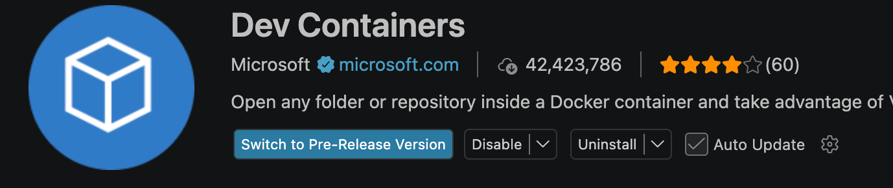

# my_cyprofile_present
learning how to make a website

---
## VScode開啟方式 ( 目前只測試在macOS上跑成功 )
### 要求
- VScode
- docker engine
- devcontainer ( a extension of VScode )

### 步驟
#### 環境安裝
- VScode: <https://code.visualstudio.com/>
- Docker官網: <https://www.docker.com/>
- devcontainer: 如下

---

#### 準備環境(如果用devcontainer開啟)
1. 確認根目錄沒有 .devcontainer ? 有的話跳到6 : 沒有繼續往下
2. 點擊VScode 的remote control (左下角)
3. 點add container configuration files
4. 選擇 nodejs (devcontainer出品)
5. 接著的其他選項不用勾
6. 確認 .devcontainer被新增後
7. 點擊remote control
8. 點擊reopen in container ( 第一次開要網路來建置 )

#### 運行
1. 進入docker後，在根目錄執行: npm run dev
2. 在將連結貼到外部網站即可看到